# Rueda Libre 
Sito web responsive y multipágina para un emprendimiento de alquiler de bicicletas y organización de recorridos guiados, con el propósito de hacer que moverse por la ciudad de Medellín sea más fácil, divertido y sostenible.

## Páginas
- `index.html`: inicio con quienes somos, carrusel de promociones, tarjetas de servicios, rutas y flota.
- `paginas/tarifas.html`: tablas con tarifas de bicicletas y recorridos, junto a un recordatorio para reservar.
- `paginas/reservas.html`:  formulario de reservas con validación e información de contacto.

## Tecnologías
- HTML5 semántico
- Bootstrap v5.3.8 (CDN)

## Framework elegido y justificación
Elegí **Bootstrap** para construir el sitio de Rueda Libre porque agilizó más el proceso de desarrollo gracias a sus componentes prefabricados y a la fácil implementación de un menú hamburguesa para móviles y un carrusel.
## Capturas
### Móvil

| Inicio (index.html)                                                                       | Tarifas (tarifas.html)                                                                                       | Reservas (reservas.html)                                                                                       |
| ----------------------------------------------------------------------------------------- | ------------------------------------------------------------------------------------------------------------ | -------------------------------------------------------------------------------------------------------------- |
| 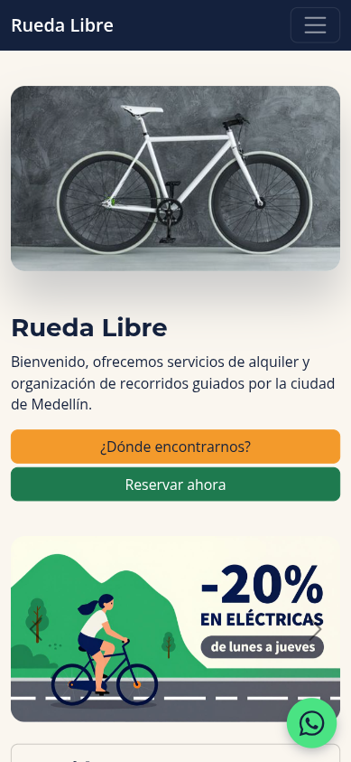             | 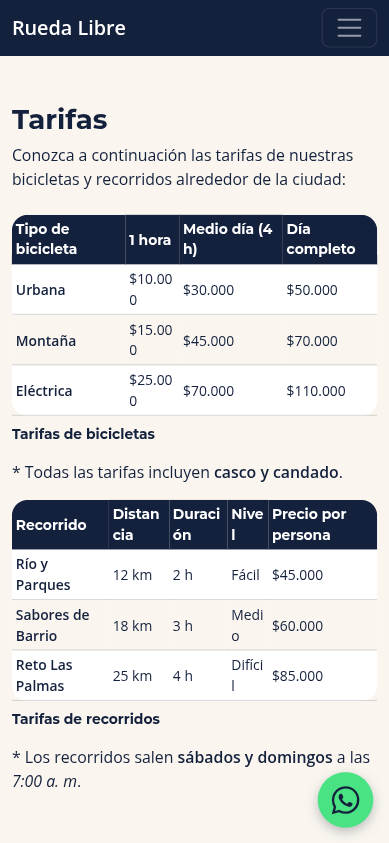                             | 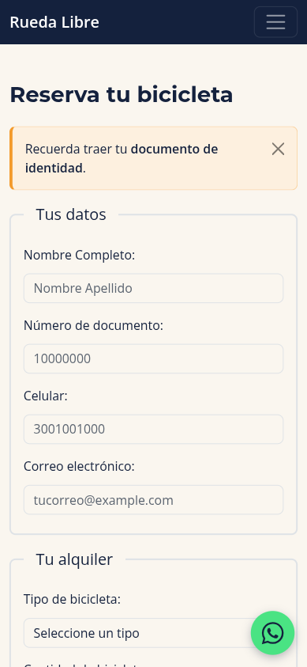                             |
| 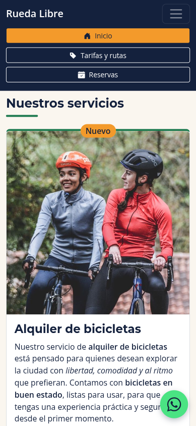 | 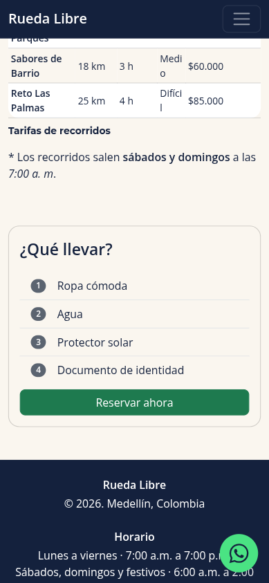 | 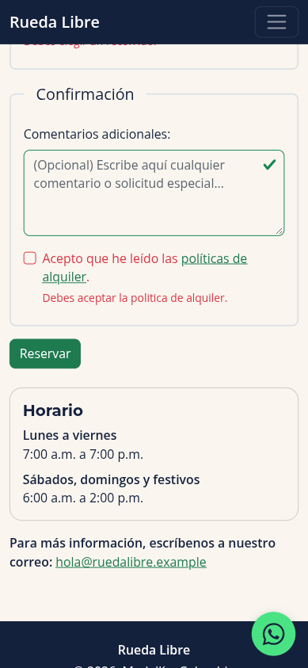 |

### Escritorio
**Inicio (index.html)**
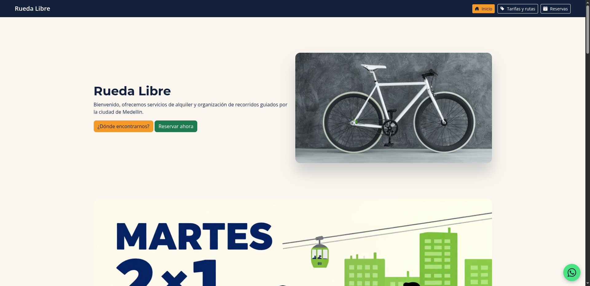
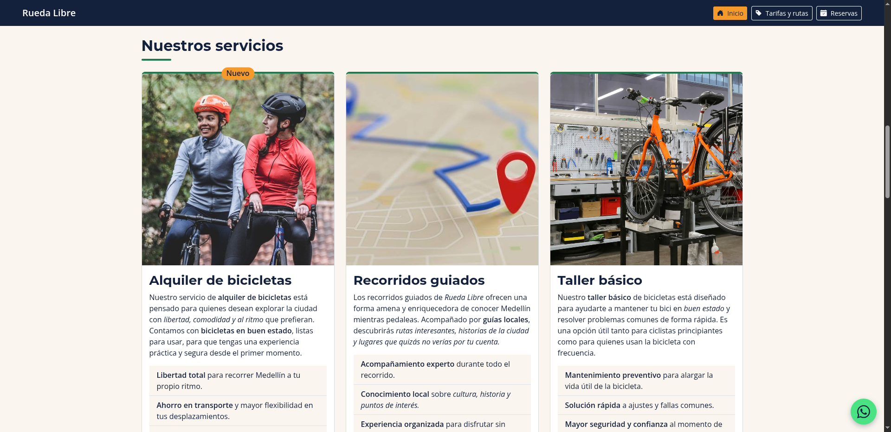

**Tarifas (tarifas.html)**
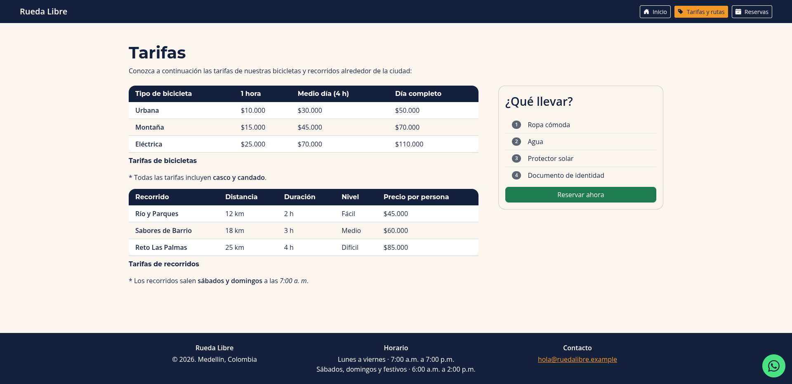

**Reservas (reservas.html)**
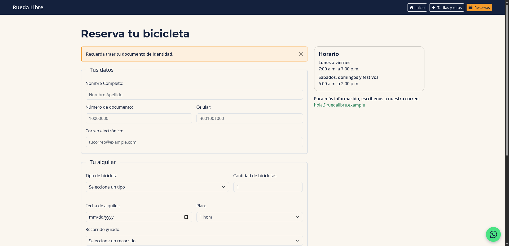
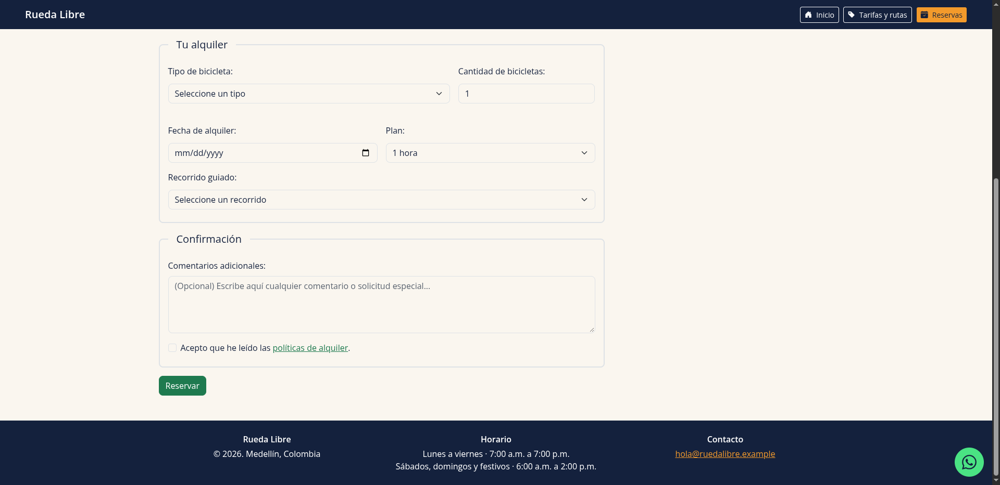

## Autor
**Felipe Bedoya** - _Coder de Riwi_ - [Github (fbizar)](https://github.com/fbizar) 
